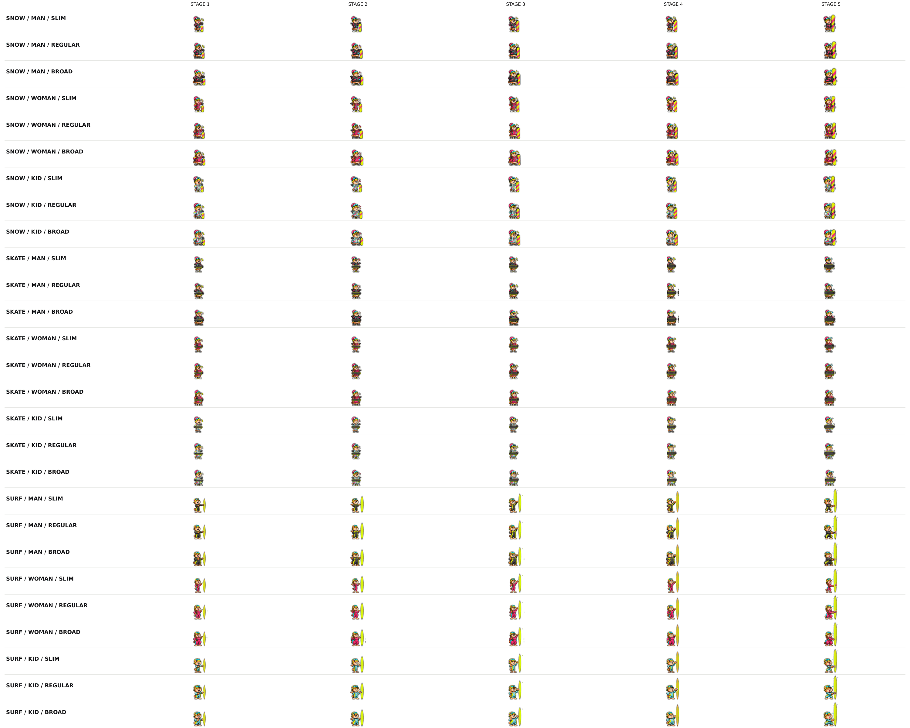

# CHATGPT_CALL: size-finder-stickers

> **ChatGPT / Codex:** follow the handshake in `AGENTS.md`. Read the **Style Bible** in `ui-art-requests.md` and the light-theme additions in `CHATGPT_RESPONSE_store-v3.md`. When finished, rename this file to `CHATGPT_RESPONSE_size-finder-stickers.md`, append a `## Response` section (every file: name, bytes, dimensions; anything not done exactly), open a PR on branch `art/size-finder-stickers` and **merge it into `main` yourself** (no human review needed). Only touch `/public/assets/` and this file.

## Why

The owner says the "Find my size" sheet doesn't match our mascot art. The sport icons (`sport-*.svg`), the Kids/Men/Women/All icons (`fit-*.svg`) and the size pictures (`preview-buddy-*` sprite sheets, drawn as a flat vector puppet) look different from Buddy in `mascot-wave.png`, `mascot-ride.png`, `mascot-skate.png`, `mascot-surf.png`, `mascot-celebrate.png`.

**Everything in this request must look like those mascot stickers:** the same Buddy (alpine marmot, lime beanie with pink pom-pom, mirrored Ice goggles, baggy jacket), the same line weight, shading and colours, thick Sticker White die-cut border plus the 2 px Asphalt hairline from the light-theme rules. Use those PNGs as the visual reference for every image; do not use the vector puppet from the sprite sheets.

The size pictures are now shown as **individual still images**: the app swaps whole pictures, it never blends two together. So each picture can be a fully drawn, expressive sticker; poses don't need to be in-betweens of each other.

## Common rules for the size pictures

- **Canvas:** 600 × 800 px, transparent, WebP with alpha, quality ~85, **≤ 160 KB** each.
- **Ground:** Buddy's feet (and the board's tail when it stands on it) on **y = 770**. Nothing within 8 px of the edges.
- **Buddy** is the same height in every picture of a persona: **520 px** from soles to the top of the pom-pom (kid Buddy too; the app scales kids down). Buddy stands left of centre (centre x ≈ 230); the board is on his right.
- **Personas:** `man` (classic Buddy, Asphalt jacket), `woman` (long braid from the beanie, eyelashes, Hot Pink jacket with Acid/Ice patches; not sexualised), `kid` (bigger head, short legs, oversized goggles, mittens, Ice jacket).
- **Builds:** `slim`, `regular`, `broad`: only body width changes; face and outfit stay identical within a persona. Broad is friendly and positive, never a caricature.
- **Boards** are generic: no logos or text. Snowboards Acid with a Hot Pink stripe; skateboards Asphalt grip with lime edge, wheels visible; surfboards Acid deck with a Hot Pink stringer.
- **Stages 1–5** go from "way too small" to "way too big", with a funny expression and posture that matches the board:
  1. way too small: bursting out laughing, pointing at the tiny board
  2. a bit small: amused shrug, "cute?"
  3. just right: big proud grin, thumbs up, arm around the board, small sparkle
  4. a bit big: "whoa", eyebrows up, leaning on it
  5. way too big: straining, knees bent, tongue out, sweat drops, wobble lines

### Board size per stage (keep the proportions; the app picks the stage)

| Sport | Stage 1 | 2 | 3 | 4 | 5 |
|---|---|---|---|---|---|
| Snow: board standing on its tail next to Buddy, length as share of Buddy's height | 0.55 (knee/thigh) | 0.70 (hip) | 0.86 (chin) | 0.98 (top of head) | 1.12 (far above) |
| Surf: board standing on its tail, length as share of Buddy's height | 1.00 (shortboard, pointy) | 1.15 (fish, swallow tail) | 1.30 (mid-length) | 1.47 (funboard, round nose) | 1.62 (big longboard / foamie) |
| Skate: deck held horizontally in front of the belly with both paws, seen from above; deck length 300 px; deck **width** | 90 px (narrow, ruler-like) | 115 px | 135 px | 160 px | 195 px (table-wide cruiser) |

For surf, Buddy is barefoot in a wetsuit (man: Asphalt with Acid panels; woman: Hot Pink with Ice panels; kid: Ice with Acid panels) and wears the lime bucket hat with pink band and Ice sunglasses pushed up (as in `mascot-surf.png`). For skate, sneakers instead of boots.

## Assets

### Asset Required: size-{sport}-{persona}-{build}-{stage}.webp (135 files)
- **Purpose:** "Find my size" picture; the app shows the one matching the rider's sport, persona, build and board size.
- **Dimensions:** 600x800, transparent WebP (see common rules).
- **Style/Theme:** Mascot sticker style exactly like `mascot-*.png`, light-theme hairline.
- **Specific Instructions:** `sport` ∈ snow, skate, surf · `persona` ∈ man, woman, kid · `build` ∈ slim, regular, broad · `stage` ∈ 1…5. Example names: `size-snow-man-regular-3.webp`, `size-surf-kid-broad-5.webp`, `size-skate-woman-slim-1.webp`. Registration (ground line, Buddy height and x position) must be identical across all files of a sport so swapping pictures doesn't jump.

### Asset Required: size-contact.png
- **Purpose:** Review sheet for the PR (not used by the app).
- **Dimensions:** 3000x2400, white background.
- **Specific Instructions:** All 135 pictures as a grid (rows: sport × persona × build, columns: stage 1–5) at reduced size with labels.

### Asset Required: pick-sport-snow.png, pick-sport-skate.png, pick-sport-surf.png
- **Purpose:** Sport choice in the size sheet and the shop header on phones (shown 28–48 px).
- **Dimensions:** 256x256, transparent PNG, ≤ 40 KB.
- **Style/Theme:** Mascot sticker, simplified to read at 28 px.
- **Specific Instructions:** Buddy's head and shoulders with the sport's board: snowboard over the shoulder + beanie; skateboard tucked under the arm; surfboard under the arm + bucket hat. Same framing in all three.

### Asset Required: pick-fit-kids.png, pick-fit-men.png, pick-fit-women.png, pick-fit-all.png
- **Purpose:** "Who's it for" choice (Kids / Men / Women / All), shown 32–48 px.
- **Dimensions:** 256x256, transparent PNG, ≤ 40 KB.
- **Style/Theme:** Mascot sticker head-and-shoulders portraits.
- **Specific Instructions:** kids = kid Buddy; men = classic Buddy; women = woman Buddy (braid); all = the three together, overlapping slightly. Same framing and head size across the set.

## Response

Completed the illustrated size-finder set: 135 individual stills, seven picker PNGs, and the final contact sheet. The existing mascot PNGs supplied the character/style reference; none of these stills use the old flat vector puppet. All files are listed in `public/assets/manifest.json`.

### Approved surf sizing amendment

The owner explicitly selected option 1 in chat: Buddy is **470 px** from soles to hat in all 45 surf stills, while the canvas remains **600 × 800**, ground **y=770**, and edge margin **at least 8 px**. Snow and skate remain as previously delivered, with the 520 px target. This supersedes the original call’s 520 px requirement for surf.

Generated surf character and board layers were exported separately so the registration and board heights could be set and measured exactly. All surf Buddy layers span **y=300–770**, with the feet anchored at **x=230**. Board centre is fixed at **x=430**. The 45 WebP exports preserve source alpha exactly.

| Stage | Board length (px) | Board top y | Tail y |
|---|---:|---:|---:|
| 1 | 470 | 300 | 770 |
| 2 | 541 | 229 | 770 |
| 3 | 611 | 159 | 770 |
| 4 | 691 | 79 | 770 |
| 5 | 761 | 9 | 770 |

The lengths use the owner’s explicit integer pixel values, including their rounding of ratio × 470. The longest board starts at y=9, retaining a 9 px top margin.

### Files delivered

| File | Bytes | Dimensions | Format |
|---|---:|---|---|
| `size-snow-man-slim-1.webp` | 40,756 | 600 × 800 | webp |
| `size-snow-man-slim-2.webp` | 40,254 | 600 × 800 | webp |
| `size-snow-man-slim-3.webp` | 40,642 | 600 × 800 | webp |
| `size-snow-man-slim-4.webp` | 41,796 | 600 × 800 | webp |
| `size-snow-man-slim-5.webp` | 43,768 | 600 × 800 | webp |
| `size-snow-man-regular-1.webp` | 44,470 | 600 × 800 | webp |
| `size-snow-man-regular-2.webp` | 43,402 | 600 × 800 | webp |
| `size-snow-man-regular-3.webp` | 42,276 | 600 × 800 | webp |
| `size-snow-man-regular-4.webp` | 43,094 | 600 × 800 | webp |
| `size-snow-man-regular-5.webp` | 45,766 | 600 × 800 | webp |
| `size-snow-man-broad-1.webp` | 44,644 | 600 × 800 | webp |
| `size-snow-man-broad-2.webp` | 43,908 | 600 × 800 | webp |
| `size-snow-man-broad-3.webp` | 43,348 | 600 × 800 | webp |
| `size-snow-man-broad-4.webp` | 43,692 | 600 × 800 | webp |
| `size-snow-man-broad-5.webp` | 44,732 | 600 × 800 | webp |
| `size-snow-woman-slim-1.webp` | 43,522 | 600 × 800 | webp |
| `size-snow-woman-slim-2.webp` | 43,878 | 600 × 800 | webp |
| `size-snow-woman-slim-3.webp` | 43,302 | 600 × 800 | webp |
| `size-snow-woman-slim-4.webp` | 45,158 | 600 × 800 | webp |
| `size-snow-woman-slim-5.webp` | 47,050 | 600 × 800 | webp |
| `size-snow-woman-regular-1.webp` | 47,188 | 600 × 800 | webp |
| `size-snow-woman-regular-2.webp` | 46,454 | 600 × 800 | webp |
| `size-snow-woman-regular-3.webp` | 45,264 | 600 × 800 | webp |
| `size-snow-woman-regular-4.webp` | 47,160 | 600 × 800 | webp |
| `size-snow-woman-regular-5.webp` | 48,602 | 600 × 800 | webp |
| `size-snow-woman-broad-1.webp` | 46,360 | 600 × 800 | webp |
| `size-snow-woman-broad-2.webp` | 46,192 | 600 × 800 | webp |
| `size-snow-woman-broad-3.webp` | 46,594 | 600 × 800 | webp |
| `size-snow-woman-broad-4.webp` | 47,874 | 600 × 800 | webp |
| `size-snow-woman-broad-5.webp` | 47,580 | 600 × 800 | webp |
| `size-snow-kid-slim-1.webp` | 43,736 | 600 × 800 | webp |
| `size-snow-kid-slim-2.webp` | 44,004 | 600 × 800 | webp |
| `size-snow-kid-slim-3.webp` | 43,264 | 600 × 800 | webp |
| `size-snow-kid-slim-4.webp` | 42,856 | 600 × 800 | webp |
| `size-snow-kid-slim-5.webp` | 44,840 | 600 × 800 | webp |
| `size-snow-kid-regular-1.webp` | 46,636 | 600 × 800 | webp |
| `size-snow-kid-regular-2.webp` | 46,056 | 600 × 800 | webp |
| `size-snow-kid-regular-3.webp` | 45,524 | 600 × 800 | webp |
| `size-snow-kid-regular-4.webp` | 45,420 | 600 × 800 | webp |
| `size-snow-kid-regular-5.webp` | 46,020 | 600 × 800 | webp |
| `size-snow-kid-broad-1.webp` | 47,524 | 600 × 800 | webp |
| `size-snow-kid-broad-2.webp` | 46,990 | 600 × 800 | webp |
| `size-snow-kid-broad-3.webp` | 47,020 | 600 × 800 | webp |
| `size-snow-kid-broad-4.webp` | 46,060 | 600 × 800 | webp |
| `size-snow-kid-broad-5.webp` | 46,104 | 600 × 800 | webp |
| `size-skate-man-slim-1.webp` | 39,332 | 600 × 800 | webp |
| `size-skate-man-slim-2.webp` | 40,670 | 600 × 800 | webp |
| `size-skate-man-slim-3.webp` | 38,940 | 600 × 800 | webp |
| `size-skate-man-slim-4.webp` | 37,524 | 600 × 800 | webp |
| `size-skate-man-slim-5.webp` | 40,876 | 600 × 800 | webp |
| `size-skate-man-regular-1.webp` | 41,152 | 600 × 800 | webp |
| `size-skate-man-regular-2.webp` | 41,390 | 600 × 800 | webp |
| `size-skate-man-regular-3.webp` | 40,402 | 600 × 800 | webp |
| `size-skate-man-regular-4.webp` | 43,608 | 600 × 800 | webp |
| `size-skate-man-regular-5.webp` | 42,980 | 600 × 800 | webp |
| `size-skate-man-broad-1.webp` | 41,922 | 600 × 800 | webp |
| `size-skate-man-broad-2.webp` | 42,476 | 600 × 800 | webp |
| `size-skate-man-broad-3.webp` | 41,494 | 600 × 800 | webp |
| `size-skate-man-broad-4.webp` | 43,158 | 600 × 800 | webp |
| `size-skate-man-broad-5.webp` | 42,928 | 600 × 800 | webp |
| `size-skate-woman-slim-1.webp` | 40,818 | 600 × 800 | webp |
| `size-skate-woman-slim-2.webp` | 42,744 | 600 × 800 | webp |
| `size-skate-woman-slim-3.webp` | 43,472 | 600 × 800 | webp |
| `size-skate-woman-slim-4.webp` | 43,700 | 600 × 800 | webp |
| `size-skate-woman-slim-5.webp` | 45,026 | 600 × 800 | webp |
| `size-skate-woman-regular-1.webp` | 43,078 | 600 × 800 | webp |
| `size-skate-woman-regular-2.webp` | 45,404 | 600 × 800 | webp |
| `size-skate-woman-regular-3.webp` | 45,378 | 600 × 800 | webp |
| `size-skate-woman-regular-4.webp` | 45,162 | 600 × 800 | webp |
| `size-skate-woman-regular-5.webp` | 47,172 | 600 × 800 | webp |
| `size-skate-woman-broad-1.webp` | 43,378 | 600 × 800 | webp |
| `size-skate-woman-broad-2.webp` | 45,078 | 600 × 800 | webp |
| `size-skate-woman-broad-3.webp` | 45,156 | 600 × 800 | webp |
| `size-skate-woman-broad-4.webp` | 44,962 | 600 × 800 | webp |
| `size-skate-woman-broad-5.webp` | 47,828 | 600 × 800 | webp |
| `size-skate-kid-slim-1.webp` | 41,612 | 600 × 800 | webp |
| `size-skate-kid-slim-2.webp` | 42,156 | 600 × 800 | webp |
| `size-skate-kid-slim-3.webp` | 41,302 | 600 × 800 | webp |
| `size-skate-kid-slim-4.webp` | 40,110 | 600 × 800 | webp |
| `size-skate-kid-slim-5.webp` | 43,506 | 600 × 800 | webp |
| `size-skate-kid-regular-1.webp` | 43,592 | 600 × 800 | webp |
| `size-skate-kid-regular-2.webp` | 43,880 | 600 × 800 | webp |
| `size-skate-kid-regular-3.webp` | 42,966 | 600 × 800 | webp |
| `size-skate-kid-regular-4.webp` | 42,098 | 600 × 800 | webp |
| `size-skate-kid-regular-5.webp` | 46,082 | 600 × 800 | webp |
| `size-skate-kid-broad-1.webp` | 44,208 | 600 × 800 | webp |
| `size-skate-kid-broad-2.webp` | 43,752 | 600 × 800 | webp |
| `size-skate-kid-broad-3.webp` | 43,246 | 600 × 800 | webp |
| `size-skate-kid-broad-4.webp` | 42,172 | 600 × 800 | webp |
| `size-skate-kid-broad-5.webp` | 45,630 | 600 × 800 | webp |
| `size-surf-man-slim-1.webp` | 39,422 | 600 × 800 | webp |
| `size-surf-man-slim-2.webp` | 42,918 | 600 × 800 | webp |
| `size-surf-man-slim-3.webp` | 42,968 | 600 × 800 | webp |
| `size-surf-man-slim-4.webp` | 42,340 | 600 × 800 | webp |
| `size-surf-man-slim-5.webp` | 45,224 | 600 × 800 | webp |
| `size-surf-man-regular-1.webp` | 38,984 | 600 × 800 | webp |
| `size-surf-man-regular-2.webp` | 40,738 | 600 × 800 | webp |
| `size-surf-man-regular-3.webp` | 41,902 | 600 × 800 | webp |
| `size-surf-man-regular-4.webp` | 40,828 | 600 × 800 | webp |
| `size-surf-man-regular-5.webp` | 45,266 | 600 × 800 | webp |
| `size-surf-man-broad-1.webp` | 40,106 | 600 × 800 | webp |
| `size-surf-man-broad-2.webp` | 43,300 | 600 × 800 | webp |
| `size-surf-man-broad-3.webp` | 43,360 | 600 × 800 | webp |
| `size-surf-man-broad-4.webp` | 42,184 | 600 × 800 | webp |
| `size-surf-man-broad-5.webp` | 45,474 | 600 × 800 | webp |
| `size-surf-woman-slim-1.webp` | 38,618 | 600 × 800 | webp |
| `size-surf-woman-slim-2.webp` | 41,558 | 600 × 800 | webp |
| `size-surf-woman-slim-3.webp` | 41,724 | 600 × 800 | webp |
| `size-surf-woman-slim-4.webp` | 40,774 | 600 × 800 | webp |
| `size-surf-woman-slim-5.webp` | 44,626 | 600 × 800 | webp |
| `size-surf-woman-regular-1.webp` | 43,824 | 600 × 800 | webp |
| `size-surf-woman-regular-2.webp` | 45,012 | 600 × 800 | webp |
| `size-surf-woman-regular-3.webp` | 44,552 | 600 × 800 | webp |
| `size-surf-woman-regular-4.webp` | 44,468 | 600 × 800 | webp |
| `size-surf-woman-regular-5.webp` | 49,544 | 600 × 800 | webp |
| `size-surf-woman-broad-1.webp` | 43,888 | 600 × 800 | webp |
| `size-surf-woman-broad-2.webp` | 46,800 | 600 × 800 | webp |
| `size-surf-woman-broad-3.webp` | 46,076 | 600 × 800 | webp |
| `size-surf-woman-broad-4.webp` | 44,786 | 600 × 800 | webp |
| `size-surf-woman-broad-5.webp` | 48,804 | 600 × 800 | webp |
| `size-surf-kid-slim-1.webp` | 40,828 | 600 × 800 | webp |
| `size-surf-kid-slim-2.webp` | 44,618 | 600 × 800 | webp |
| `size-surf-kid-slim-3.webp` | 43,476 | 600 × 800 | webp |
| `size-surf-kid-slim-4.webp` | 43,492 | 600 × 800 | webp |
| `size-surf-kid-slim-5.webp` | 48,224 | 600 × 800 | webp |
| `size-surf-kid-regular-1.webp` | 42,170 | 600 × 800 | webp |
| `size-surf-kid-regular-2.webp` | 44,622 | 600 × 800 | webp |
| `size-surf-kid-regular-3.webp` | 44,146 | 600 × 800 | webp |
| `size-surf-kid-regular-4.webp` | 44,188 | 600 × 800 | webp |
| `size-surf-kid-regular-5.webp` | 49,162 | 600 × 800 | webp |
| `size-surf-kid-broad-1.webp` | 42,446 | 600 × 800 | webp |
| `size-surf-kid-broad-2.webp` | 45,306 | 600 × 800 | webp |
| `size-surf-kid-broad-3.webp` | 45,998 | 600 × 800 | webp |
| `size-surf-kid-broad-4.webp` | 46,330 | 600 × 800 | webp |
| `size-surf-kid-broad-5.webp` | 49,628 | 600 × 800 | webp |
| `pick-sport-snow.png` | 18,328 | 256 × 256 | png |
| `pick-sport-skate.png` | 17,395 | 256 × 256 | png |
| `pick-sport-surf.png` | 16,399 | 256 × 256 | png |
| `pick-fit-kids.png` | 17,790 | 256 × 256 | png |
| `pick-fit-men.png` | 18,195 | 256 × 256 | png |
| `pick-fit-women.png` | 18,855 | 256 × 256 | png |
| `pick-fit-all.png` | 22,411 | 256 × 256 | png |
| `size-contact.png` | 241,333 | 3000 × 2400 | png |
| `manifest.json` (updated) | 46,401 | — | json |

### Validation and limits

- Verified all 135 stills are 600 × 800 WebP with alpha and ≤160 KB, all seven picker PNGs are 256 × 256 and ≤40 KB, and the contact sheet is an opaque white 3000 × 2400 PNG.
- All 45 surf character layers measure exactly 470 px high, have the same x=230 feet anchor and y=770 ground, and use the exact stage-specific board lengths above. Every final still retains at least the 8 px edge margin. Temporary layer masks and final encoded alpha were checked.
- Hashes confirm all 90 snow/skate stills and all seven picker PNGs are byte-for-byte unchanged from the draft. Their earlier 520 px framing target, painted head details, illustrative board proportions and roughly 2 px antialias tolerance remain as previously reported.
- These are separately rendered expressive illustrations. Fine painted face/outfit details can differ between poses/builds; they are not pixel-identical copies of a shared face layer. Surf layout and board registration are calibrated independently of those painting details.
- No app code was modified. The final contact sheet contains the actual 135 delivered stills; all provisional surf labels are removed.

### Project checks

- `npm test`: passed, 233 tests across 8 files.
- `npm run build`: passed.
- `npm run typecheck`: passed after the production build.
- Final contact sheet and representative woman/kid stage images were visually inspected after export.
